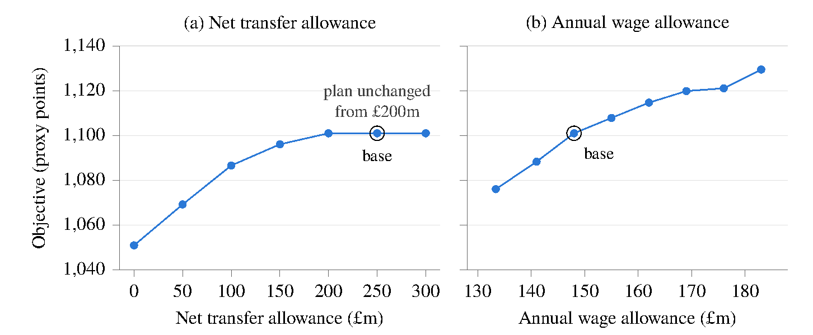

# Manchester United Transfer Window Optimisation

A binary integer program, built in Python and solved with Gurobi, that plans Manchester United's summer 2025 transfer window: which players to sell, which to buy, how to organise the squad and who starts.

**NUS MSc in Business Analytics · DBA5103 Operations Research and Analytics · Group 20 · November 2026**

[Read the report (PDF)](report/report.pdf) · [See the model code](src/transfer_model.py) · [Get the data](data/raw/README.md)

## The problem

United finished 15th in the 2024/25 Premier League, so the summer 2025 window mattered. Transfer choices cannot be made one player at a time. Each purchase uses budget, adds a wage, takes one of a limited number of arrival places and may need a registration place. Each sale returns money and wage room but removes cover. The project takes the position of a planner on 1 June 2025, using only records dated up to 31 May 2025, and decides all of these choices together.

## Approach

**Data.** Match, line-up, transfer and valuation records come from the public Transfermarkt-derived [transfermarkt-datasets](https://github.com/dcaribou/transfermarkt-datasets) (CC0). The candidate pool holds 806 players aged 26 or under from the five largest European leagues; 296 can be bought in the base case after the two-year, club and fee rules. United's 24 existing players come with wages from a third-party payroll table.

**Quality score.** Each eligible player-role pair gets a 0 to 100 proxy score built from playing time, output (goals and assists, or goals conceded for defenders), team level and market value, each turned into a percentile within the role. It is a proxy for squad quality, not a prediction of league points.

**Model.** A binary integer linear program with five families of binary variables: sell $s_p$, buy $b_p$, squad membership $x_p$, cover role $z_{pg}$ and starting role $y_{pg}$. It maximises the quality of the starting eleven plus 0.3 times the quality of the reserves:

$$
\max \; Z = \sum_{(p,g)\in H} q_{pg}\, y_{pg} \;+\; \mu \sum_{(p,g)\in H} q_{pg}\,(z_{pg} - y_{pg}), \qquad \mu = 0.3
$$

subject to:

| Constraint | Meaning |
|---|---|
| Squad linking | A kept existing player or a bought candidate is in the squad |
| One cover role per player; starters start in their cover role | No player is counted twice |
| Formation | Exactly eleven starters in a 3-4-2-1 (1 GK, 3 CB, 2 WB, 2 CM, 2 AM, 1 ST) |
| Cover bounds | Minimum and maximum players per role, giving a squad of 21 to 29 |
| Net transfer spending | Fees minus sale receipts within £250m |
| Annual wages | Squad wages within £148m a year |
| Transfers | At most 6 arrivals and 6 sales |
| Registration | At most 25 senior players, of whom at most 17 not home-grown |

The base model has 1,502 binary variables and 1,096 constraints. Gurobi solves it to proven optimality in about 0.02 seconds.

## Results

**Recommended plan** (under the stated assumptions):

| Purchases | Role | Club at cutoff | Fee (£m) | Wage (£m/yr) |
|---|---|---|---:|---:|
| Lucas Chevalier | GK | LOSC Lille | 27.76 | 5.72 |
| Piero Hincapié | CB | Bayer 04 Leverkusen | 63.09 | 10.40 |
| Ritsu Doan | WB | SC Freiburg | 20.36 | 5.72 |
| Éderson | CM | Atalanta BC | 63.09 | 10.40 |
| Bryan Mbeumo | AM | Brentford FC | 50.89 | 10.40 |
| Jonathan David | ST | LOSC Lille | 0.00 (free) | 7.80 |

Sales: Harry Maguire, Casemiro and Luke Shaw. The plan raises the objective from 876.47 (no transfers) to 1,100.96, spends £198.69m net of the £250m allowance and uses £147.94m of the £148m wage allowance.

<p align="center"></p>

**Main findings**

- **Wage room and arrival places limit the plan, not the transfer allowance.** Each point in the figure above is a separate optimal run. Moving each limit one step changes the objective as follows:

  | One step | Change in objective (points) |
  |---|---:|
  | One more / one fewer arrival | +20.5 / −28.7 |
  | £7m more / less wages | +6.9 / −12.7 |
  | £50m more or less budget | 0 |

  The dual prices of the linear relaxation point the same way.
- **The model is easy to solve for a structural reason.** With the transfers fixed, assigning players to roles is a network flow problem, whose constraint matrix is totally unimodular. The linear relaxation sits only 0.08 points above the integer optimum, and Gurobi solves at the root node.
- **Protecting the wage limit is cheap.** A Bertsimas–Sim robust version guards against up to Γ purchases earning 10% more than estimated. Full protection costs 7.5 points (0.7%), and Doan, Chevalier and David are bought at every level.
- **Stable core.** Across the 17 sensitivity runs that change the plan:

  | Purchase | Kept in (of 17) |
  |---|---:|
  | Doan, David | 17 |
  | Chevalier | 16 |
  | Mbeumo | 13 |
  | Hincapié | 6 |
  | Éderson | 4 |

  Hincapié and Éderson are also the cheapest to replace: losing both costs only 2.46 points.
- **Later outcomes describe, they do not validate.** The six purchases played between 50% and 78% of their club's league minutes in 2025/26. United's actual arrivals had higher playing time and value growth, and the groups are small and unmatched, so this is not evidence of better recruitment.

## How the results were checked

- 18 small invented cases are compared with hand-worked optima and with a search over every possible plan.
- 51 focused checks test the data rules (club identification, transfer spells, fee and wage rules).
- An independent function recomputes every limit and the objective for all 77 reported runs.
- The inputs were built twice with identical results.
- The 2025/26 evaluation was recomputed from the raw records.
- The robust method was checked against a full search of the invented example.
- The recommendation was frozen on 17 November 2026, with file fingerprints, before any 2025/26 outcome was opened. The later correction and additional analyses are labelled as post-freeze work and kept in separate folders.

## Limitations

- The quality score lacks defensive and goalkeeping statistics, and it gives weight to market value, which also sets the fees.
- Fees are multiples of estimated market value. Candidate wages are assumed bands, and United's wages come from a later table.
- Injury risk, player development, contract terms and the willingness of clubs to sell are not modelled.
- The study is retrospective: it was carried out in November 2026 by people who already knew parts of what happened in 2025.

## Repository guide

| Path | Contents |
|---|---|
| [`report/report.pdf`](report/report.pdf) | The final 49-page report: problem, data, formulation, method, results, evaluation and appendices with the complete model code. Student IDs are withheld in this public copy |
| [`report/latex/`](report/latex/) | LaTeX source of the report; tables and the figure are generated from the saved outputs |
| [`src/transfer_model.py`](src/transfer_model.py) | The optimisation model: one function builds and solves every run |
| [`src/`](src/) | Data preparation, scoring, scenario runs, independent checks, evaluation, the additional analyses and table generation |
| [`data/processed/`](data/processed/) | Model inputs built from the raw records (players at the cutoff, seasons, role starts, candidate pool, scores) |
| [`data/manual/`](data/manual/) | United wages extracted from the payroll table, with the source address |
| [`data/raw/`](data/raw/) | Instructions and checksums for the raw Transfermarkt files, which are attached to the `data-v1` release |
| [`data/toy/`](data/toy/), [`demo/`](demo/) | An eight-player invented example and a runnable driver |
| [`docs/`](docs/) | Current assumptions, dated decision log, data dictionary and the hand-entered lists (unavailable players, free agents, shortlist checks, actual arrivals) |
| [`results/`](results/) | The original runs and freeze of 17 November 2026, the evaluation, the corrected runs of 18 November used in the report and the additional runs of 21 and 22 November |

## Run it

Use Python 3.12. A Gurobi licence is needed to solve the real model. The licence bundled with `gurobipy` is enough for the toy checks and the base model, but one sensitivity run exceeds its size limit; a free academic licence covers everything.

```bash
git clone https://github.com/DarkMatter-404/Manchester-United-Transfer-Window-Optimisation.git
cd Manchester-United-Transfer-Window-Optimisation
python3.12 -m venv .venv && source .venv/bin/activate
pip install -r requirements.txt

python src/toy_model.py                                      # 18 checks on invented cases
python src/run_scenarios.py --out results/corrections/rerun/model   # base plan and all 56 runs
python src/extra_runs.py --out results/corrections/rerun/extra      # limits, robust wages, LP relaxation
```

These commands use the processed inputs that are already included. To rebuild them from the raw records, download the release files (see [`data/raw/README.md`](data/raw/README.md)), then run `prepare_inputs.py`, `build_player_pool.py` and `score_players.py` in that order. Scripts write only to the folder named with `--out` and refuse to overwrite the original result folders.

Two scripts are kept for the record but cannot run from this copy:
- `extract_united_wages.py` reads the third-party payroll printout, which is not redistributed; its output is in `data/manual/united_wages.csv`.
- `compare_corrections.py` reads the history of the private development repository.

Saved run records and manifests keep the paths and commit references of that repository.

**Tools:** Python, Gurobi (gurobipy), DuckDB, pdfplumber, LaTeX (XeLaTeX with pgfplots).

## Team and provenance

This is a **group project**, presented on Aman Raj Mohta's portfolio. The team members are:

- Aman Raj Mohta
- Raisha Moira Shaqinna
- Swarupa Litke
- Ritzke Aisyarah
- Tawmo
- Sulistyo Agung Wibowo

The work was developed in the team's private repository. This public copy contains the model, data pipeline, inputs, saved results and the report from Aman's workstream; the report is the team's joint submission of 22 November 2026, unchanged except that student IDs are withheld. The report's statement on assistance describes the AI tools used (Claude through Claude Code, and ChatGPT through Codex).

The Transfermarkt-derived data are published by dcaribou under CC0-1.0. The United wage figures are third-party estimates included with their source; the payroll printout and the course's project guideline are not included. No open-source licence is asserted for the jointly authored report.
